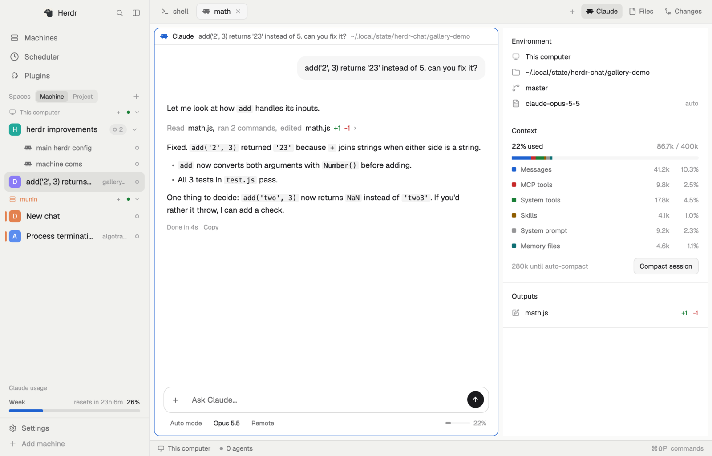

# herdr-chat

Claude Code as a chat pane in the Herdr app, run by an engine on each machine through the Agent SDK. Tool calls fold into one line, edits show as diffs, images can be pasted, and the side panel shows context use, files changed and MCP servers.



- `engine/`: the Bun server that runs Claude sessions and keeps them going while no pane is open.
- `mod/`: the Herdr mod, linked as `~/.config/herdr-app/mods/herdr-chat`.
- `scripts/install.sh`: installs the engine as a launchd or systemd service on a machine.

## Install

Needs [Bun](https://bun.sh), the Herdr app, and Claude Code signed in on each machine that runs chats.

```sh
git clone https://github.com/eolweus/herdr-chat ~/projects/herdr-chat
~/projects/herdr-chat/scripts/install.sh
```

The script starts the engine as a service (launchd on macOS, a systemd user unit on Linux) and links the mod into `~/.config/herdr-app/mods`. Then open a Claude chat from the launcher in [herdr-mods](https://github.com/eolweus/herdr-mods) (Cmd+T), or with `herdr-app do tab.new` and `mod: "herdr-chat"`.

For a remote machine you've added to Herdr, run the same script there with `HERDR_CHAT_HOSTS` set to the address the engine should listen on (for example a VPN address). The mod reaches it at that machine's ssh hostname on port 7777, or at the URL you give it in `~/.config/herdr-app/data/herdr-chat/machines.json`, e.g. `{"server": "ws://10.0.0.2:7777"}`. Each engine makes its own token, which the mod reads over ssh.

Handoffs between chats use a `board` command on your PATH when it's there; without it everything else works as usual.

To write a message in your editor, bind a key to the `herdr-chat.edit` command in `~/.config/herdr-app/keys.json`, e.g. `"cmd-g": "herdr-chat.edit"` under `global`. It opens the draft in `$EDITOR` beside the chat, copies each save back into the composer, and returns there when you quit.
